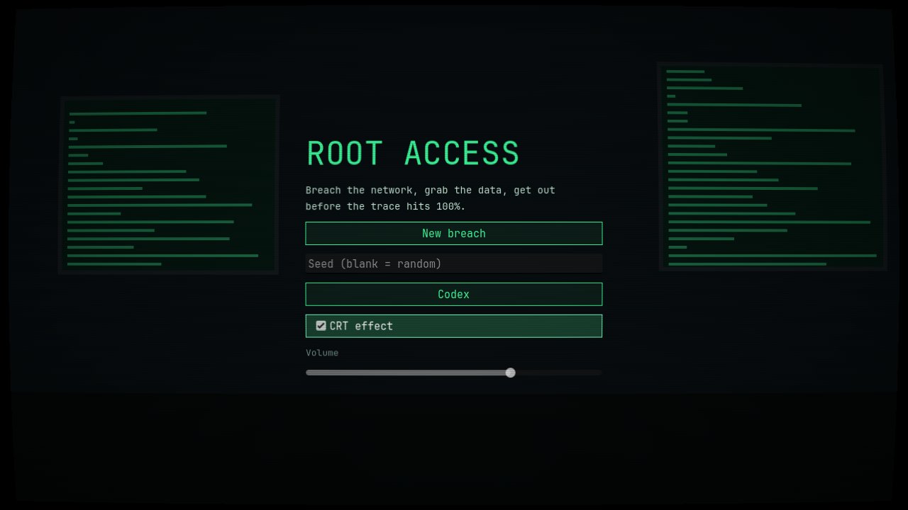

# Root Access

**Roguelike deckbuilder: breach the network before the blue team traces you.**



## About

Root Access is a 2D roguelike deckbuilder. You play a hacker breaching a procedurally generated corporate network one host at a time. Every exploit you play makes noise, and noise feeds a global **Trace** meter. Grab the data and get out before the trace hits 100%.

*Slay the Spire meets Hacknet.*

- **Network map:** a procedurally generated graph of hosts hidden under fog of war. Recon reveals what each node is, including honeypots made to look like loot, shops and safehouses.
- **Card combat:** spend **CPU** each turn to play Recon, Exploit, Social, Stealth, Persistence, Escalation and Payload cards against defenders such as firewalls, antivirus, IDS sensors and sysadmins.
- **Trace meter:** a 0–100% meter that sets the pace. Playing loud is fast but escalates the defenders. Playing quiet is safe but drains your hand.
- **Seeded runs:** enter a seed to replay or share a specific run, or leave it blank for a random one.
- **Responsible realism:** cards are named after real techniques and follow the real kill chain, but their effects are abstract. The game teaches how attacks flow without giving any working instructions. Codex entries explain how each technique is detected and prevented.

The full design is in [Root Access — Game Design Document.md](Root%20Access%20—%20Game%20Design%20Document.md) and [docs/](docs/).

## Tech

- Godot **4.7**, GDScript, GL Compatibility renderer
- Data-driven content: cards, defenders and node types are `.tres` resources in `data/`
- Export targets: Web (HTML5), Windows, Linux

## Getting started

### Requirements

- [Godot 4.7+](https://godotengine.org/download). The standard build is enough; the project doesn't use C#.

### Quick start (Windows)

```bat
runner.bat          :: run the game
runner.bat editor   :: open the project in the Godot editor
```

`runner.bat` looks for Godot at `%USERPROFILE%\Downloads\Godot_v4.7.2-stable_mono_win64\`. To use a different install, set the `GODOT` environment variable:

```bat
set GODOT=C:\Tools\Godot\Godot_v4.7.2-stable_win64.exe
runner.bat
```

### Any platform

```sh
godot --path .            # run the game
godot --path . --editor   # open the editor
```

You can also open the Godot Project Manager, choose **Import**, select `project.godot`, then press **F5**.

### Exporting

Export presets for Web, Windows and Linux are in `export_presets.cfg` (you need Godot's export templates installed):

```sh
godot --headless --path . --export-release "Web" build/web/index.html
godot --headless --path . --export-release "Windows" build/windows/RootAccess.exe
godot --headless --path . --export-release "Linux" build/linux/RootAccess.x86_64
```

### Tests

Unit tests use [GUT](https://github.com/bitwes/Gut) and live in `tests/`. To run them, install GUT into `addons/gut/` and run:

```sh
godot --headless --path . -s addons/gut/gut_cmdln.gd
```

## Project structure

```
autoload/   Global singletons: GameState, EventBus, SaveManager, AudioManager
data/       Card, defender and node definitions (.tres)
scenes/     Main menu, map, encounter and UI scenes
shaders/    CRT, glitch and fog effects
assets/     Fonts and UI theme
tests/      GUT unit tests
tools/      Headless balance simulation
docs/       Design and implementation notes
```

## License

[MIT](LICENSE) © 2026 Dmytro Maistruk
